# 사용 시나리오 — 애월에 카페를 열려는 서윤 씨, 센터에서 한 시간

> 아래 화면과 파일은 2026-11-03에 앱을 처음부터 끝까지 실제로 돌려 얻은 그대로다(체험 모드, AI 켬).
> - **2026-11-10 덧붙임**: 이 기록 뒤에 경쟁(가게 수, 상가정보)·최근 방문객(관광공사)·지구 유형(데이터허브) 카드가 실제 값으로 더해졌고, 체험용 가상 데이터 생성기를 고쳐 체험 수치가 조금 달라졌다(예: 관광객 몫 61.2% → 60.3%, 카페 매출 순위 2위 → 4위). 아래 "가게 수는 알 수 없다"는 문장도 지금은 경쟁 카드로 채워진다. 최신 실행 결과는 `docs/submission/결과_설명자료.pdf`에 있다.
> - 센터 카드 수치(61%, 1.6배, 2위 등)는 **체험용 가상 데이터** 값이다. 실제 센터 데이터로 돌리면 달라진다.
> - 공개 데이터 수치(제주데이터허브 597)는 **실제 값**이다.
> - 지원사업 건수는 그날 모집 중이던 공고 기준이다.
> - 인물은 가상이다. 이 방문의 AI 비용은 약 $0.0009(질문 해석 $0.0001 + 자격 대조 $0.0008)였다.

## 등장인물

**한서윤(가상, 34세)** — 서울에서 바리스타로 7년 일하다 제주로 온 지 2년째. 애월읍에 20석짜리 카페를 열 준비를 하고 있다.

**목표** — 2주 뒤 마감인 예비창업자 지원사업 사업계획서의 '시장 현황' 칸을 숫자 근거로 채우기.

**방문 전에 막혀 있던 것**
1. "애월은 관광객이 많다"는 감만 있다. 온라인 상권 서비스는 관광객과 도민을 나눠 보여 주지 않는다.
2. 센터 데이터 73종 중 무엇을 골라야 할지 모른다. 받은 CSV는 컬럼명이 영어(`bjd`, `use_amt` …)이고 코딩은 못 한다.
3. 반출 규정(10 미만 값 반출 불가, 그림은 PNG만)을 모른다. 반려되면 마감을 놓친다.
4. 모집 중인 지원사업 공고가 1,500건이 넘어 자기가 낼 수 있는 것을 못 고른다.

## 한눈에 보기

| 때 | 어디서 | 한 일 |
|---|---|---|
| D-14 | 전화 | 방문 예약, 직원이 필요한 표 3개를 안내 |
| 10:00 | 센터 PC | ① 질문 |
| 10:02 | 센터 PC | ② 데이터 준비(CSV 3개 내려받기, 화면이 자동 인식) |
| 10:20 | 센터 PC | ③ 결과(결론 카드, 근거 카드 6장) |
| 10:30 | 센터 PC | ④ 가져가기(지원사업, 반출 묶음, 반출 신청) |
| 10:50 | 센터 PC | 퇴실 전 지우기 |
| D-9 | 집 | 반출 승인, 묶음 받기 |
| D-7 ~ D-5 | 집·온라인 | 근거팩을 사업계획서에 옮겨 제출 |

---

## D-14 · 방문 예약 (전화)

서윤 씨가 "애월에 카페를 내려는데 관광객 장사가 될지 알고 싶다"고 말하면, 직원은 운영자 페이지의 '방문 예약 준비'에 그 질문을 넣는다. 필요한 센터 표 3개(1-08 동네·업종별 월 매출, 1-12 요일별, 1-14 시간대별)와 기간이 나오고, 직원은 그 안내문을 보내 준다. 준비물은 질문 하나뿐이다.

## 10:00 · ① 질문 — 평소 말투로 묻는다

'가게 열기·사업계획서'를 고르고 **"애월에 카페 차리려는데, 관광객 장사가 될까요?"**라고 적는다.

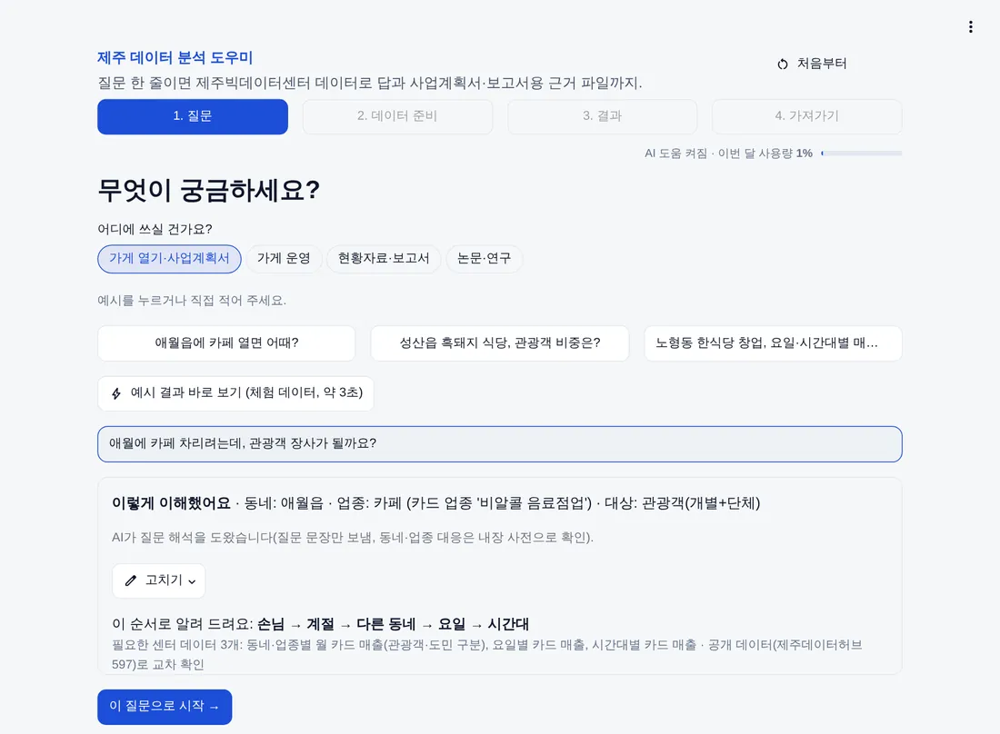

**이 단계에서 얻은 것**
- "애월" → 법정동 **애월읍**, "카페" → 카드 업종 **'비알콜 음료점업'**, 대상 **관광객(개별+단체)**
- 알려 줄 순서(손님 → 계절 → 다른 동네 → 요일 → 시간대)와 필요한 센터 데이터 3개
- AI는 질문 문장만 받아 표현을 뽑았다(비용 $0.0001). 동네·업종 대응은 내장 제주 지명 사전으로 확인했다.

## 10:02 · ② 데이터 준비 — 내려받기만 하면 화면이 알아본다

화면 안내대로 센터 데이터 조회 화면에서 '카드 이용 현황(읍면동)_v02'를 고르고 기간(2025년 11월 ~ 2026년 10월)을 넣어 CSV로 내려받는다. 앱 화면으로 돌아오면 이미 "준비됨"이 붙어 있고 다음 표의 안내가 펼쳐져 있다. 세 번째 파일까지 들어오면 "데이터 3개가 모두 준비돼 결과로 넘어갑니다" 알림과 함께 결과로 넘어간다.

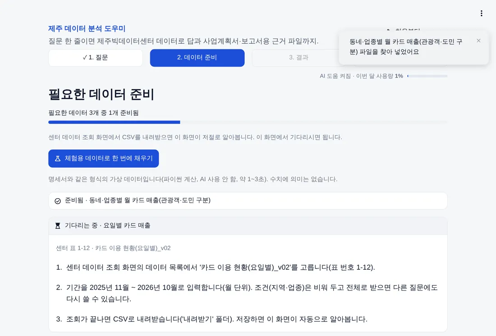

서윤 씨는 영문 컬럼명 CSV를 한 번도 열어 보지 않았다.

## 10:20 · ③ 결과 — 결론부터 받는다

Agent가 6단계를 2.7초에 끝내고(재현 번호 `R-20261103-74d599`) 맨 위에 결론 카드를 띄운다.

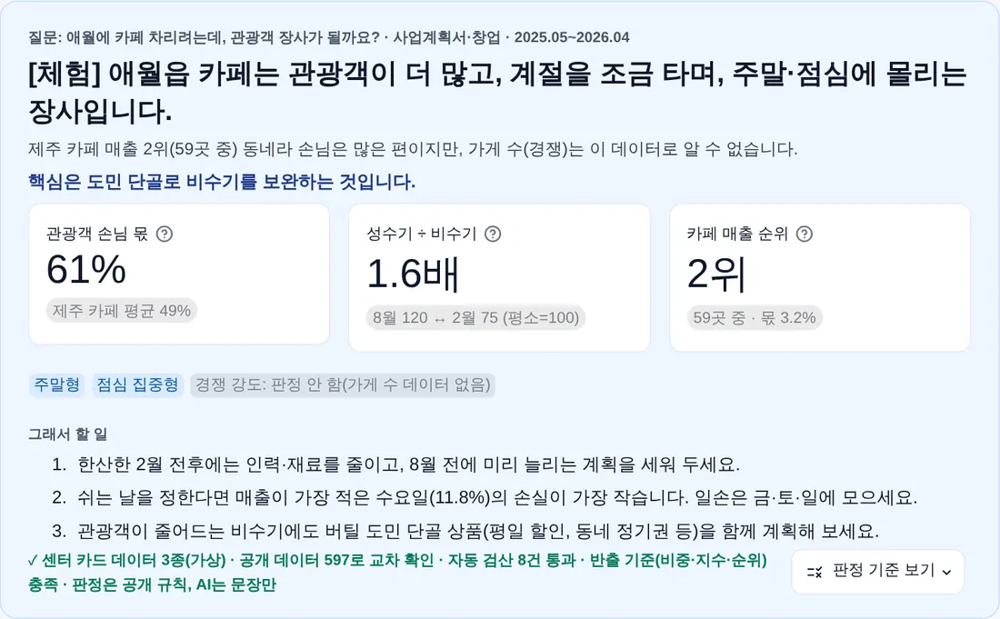

> **애월읍 카페는 관광객이 더 많고, 계절을 조금 타며, 주말·점심에 몰리는 장사입니다.**
> 제주 카페 매출 2위(59곳 중) 동네라 손님은 많은 편이지만, 가게 수(경쟁)는 이 데이터로 알 수 없습니다.
> 핵심은 도민 단골로 비수기를 보완하는 것입니다.

| 관광객 손님 몫 | 성수기 ÷ 비수기 | 카페 매출 순위 |
|---|---|---|
| **61%** (제주 카페 평균 49%) | **1.6배** (8월 120 ↔ 2월 75, 평소=100) | **2위** (59곳 중 · 몫 3.2%) |

**그래서 할 일**
1. 한산한 2월 전후에는 인력·재료를 줄이고, 8월 전에 미리 늘리는 계획을 세워 두세요.
2. 쉬는 날을 정한다면 매출이 가장 적은 수요일(11.8%)의 손실이 가장 작습니다. 일손은 금·토·일에 모으세요.
3. 관광객이 줄어드는 비수기에도 버틸 도민 단골 상품(평일 할인, 동네 정기권 등)을 함께 계획해 보세요.

[판정 기준 보기]를 열면 결론을 낸 규칙이 그대로 나온다(관광객 몫 55~65%면 '관광객 장사', 가장 많은 달 ÷ 가장 적은 달 1.5~2.0배면 '계절 영향 있음', 토+일 비중 33% 이상이면 '주말형'). 결론은 AI가 아니라 이 규칙이 정하므로, 심사위원이 근거를 물어도 그대로 설명할 수 있다.

| 근거 카드 | 화면 제목(그대로) | 서윤 씨가 얻은 것 |
|---|---|---|
| 손님 구성 | 애월읍 카페 손님 돈의 61.2%는 관광객 지갑에서 나옵니다 | "100원을 벌면 61원은 관광객" — 신청서 첫 문장 |
| 월별 흐름 | 가장 잘 되는 8월이 가장 한산한 2월의 1.6배입니다 | 인력·재고 계획의 근거 |
| 요일 | 금·토·일 사흘에 매출의 49.5%가 몰립니다 — 토요일이 가장 많음(17.6%) | 휴무일을 수요일로 정함 |
| 시간대 | 점심(11~14시)에 매출이 가장 몰립니다(28.1%) | 1시간당으로 보면 점심이 가장 바쁨, 밤 영업은 줄임 |
| 시장 크기 | 애월읍은 제주 카페 매출 2위 동네입니다(59곳 중) | 수요는 크다, 경쟁(가게 수)은 따로 확인 |
| 공개 데이터 | 제주시 읍면 지역 식음료 매출의 65.0%가 내국인 관광객입니다(2016~2018) | 누구나 확인할 수 있는 **실제 값**으로 같은 방향 확인 |

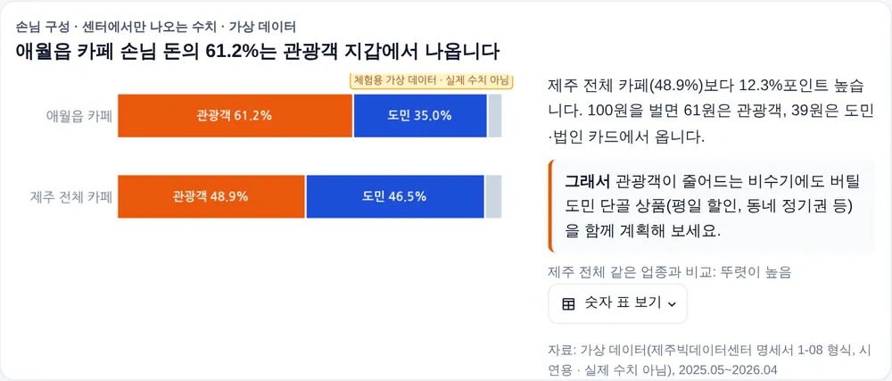
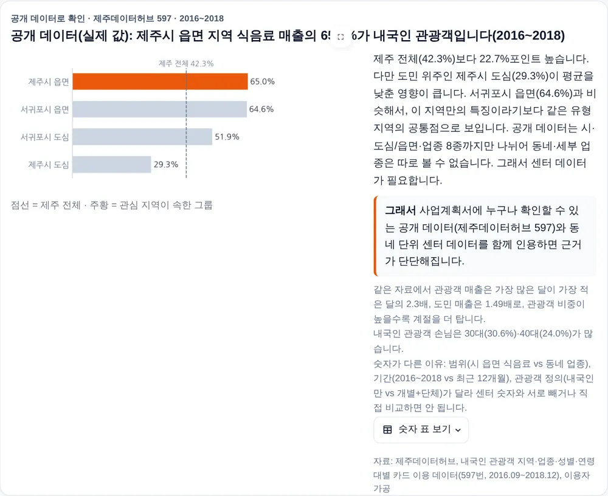

'주의할 점'에서 비씨카드 결제만 집계했고, 가게 수가 없어 경쟁 강도는 판정하지 않았다는 것을 본다. 서윤 씨는 같은 동네 카페 수를 소상공인365에서 따로 확인하기로 메모한다.

## 10:30 · ④ 가져가기 — 낼 수 있는 지원사업과 반출 묶음

칩 세 개를 고른다: 지금 상태 '창업 준비 중', 대표자 나이대 '39세 이하', 가게 위치 '제주시'.

> 모집 중 1,532건 → 조건으로 1,511건 거름 → 17건 중 상위 15건 판정 (업종: 카페, 질문에서 가져옴)

[AI로 공고문과 자격 대조하기]를 누르면 10초쯤 뒤 공고마다 판정과 이유가 붙는다(비용 $0.0008, 보낸 것은 입력한 조건과 공고문뿐).

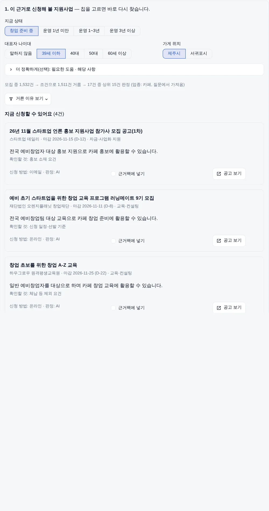

| 판정 | 공고 · AI가 붙인 이유 |
|---|---|
| 지금 신청 | 창업 초보를 위한 창업 A-Z 교육(D-22) — 예비창업자 대상 창업교육으로 카페 창업 준비에 활용할 수 있습니다. |
| 지금 신청 | 스타트업 언론 홍보 지원사업(D-12) — 전국 예비창업자 대상이며 카페 창업 홍보에 활용할 수 있습니다. |
| 지금 신청 | 예비 초기 스타트업 창업 교육 러닝메이트 9기(D-8) |
| 지금 신청 | 스타트업·소상공인 언론홍보 무료 기사 배포(D-58) |
| 가게 연 뒤 | [제주] 식품진흥기금 융자, 소상공인 고용보험료 지원, 대출안심보험, 이차보전금, 1인 소상공인 출산급여 (5건, 3건은 방문 접수) |
| 조건 확인 | 소상공인 지원사업 통합 공고 외 3건 — 예비창업자 대상 사업이 포함되지만 세부사업별 자격과 지원내용이 다릅니다. |

AI 플랫폼·투자 유치·입주 공간 같은 기술 스타트업용 공고는 '기술·투자·입주 중심 공고(가게 창업과 무관)'로 처음부터 걸러져 보이지 않는다. 서윤 씨는 '창업 A-Z 교육'을 근거팩에 넣고, 활용 사유를 "애월읍 카페 예비창업자 지원사업 사업계획서 시장분석 근거"로 고친 뒤 [반출 신청 묶음 만들기]를 누른다.

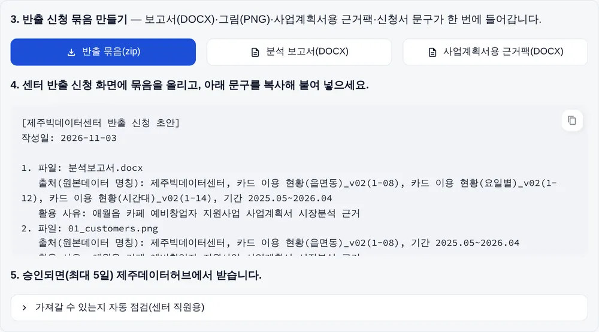

신청서 문구를 복사해 센터 반출 신청 화면에 붙여 넣는다. 직원은 [가져갈 수 있는지 자동 점검]에서 모든 항목이 비중·순위·지수(응용집계)이고 원본 데이터가 없으며 그림이 PNG인 것을 보고 접수한다.

## 10:50 · 퇴실 전 지우기

[퇴실 전 내 작업 지우기]를 누르면 이 화면이 읽어 들인 내려받기 폴더의 CSV 이름까지 보여 주고, 질문·결과와 함께 지운다. 앱이 읽지 않은 다른 파일은 건드리지 않는다.

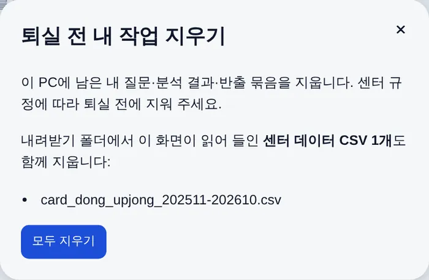

## D-9 ~ D-5 · 집에서

반출 승인(최대 5일) 뒤 제주데이터허브에서 묶음을 받는다. 근거팩은 사업계획서 양식 순서(문제인식 → 실현가능성 → 성장전략 → 팀 구성)로 정리돼 있어, 항목마다 문단·그림·'사업계획서 문장 예시'·출처를 옮기고 자기 말로 다듬기만 하면 된다. 팀 구성만 직접 쓴다. D-5에 신청서를 낸다. 개업 뒤에는 '가게 연 뒤' 공고 5건을 신청하고, 보고서의 '다음 방문 때 이어서 하려면'에 적힌 질문·표로 최신 기간을 다시 볼 생각이다.

---

## 서윤 씨가 가져간 것 (반출 묶음 zip 그대로)

| 파일 | 내용 |
|---|---|
| `지원사업_근거팩.docx` (6쪽) | 한 줄 요약 → 1. 문제인식 → 2. 실현가능성 → 3. 성장전략(수치 근거 4줄) → 4. 팀 구성(직접 작성 안내) → 부록(고른 지원사업, 출처·한계) |
| `분석보고서.docx` (9쪽) | 결론, 근거 카드, 공개 데이터 교차 확인, 주의할 점, 다음 방문 때 이어서 하려면, 판정 기준 부록 |
| 그림 PNG 6장 | 01 손님 구성 · 02 월별 흐름 · 03 요일 · 04 시간대 · 05 동네 순위 · 06 공개 데이터 |
| `반출신청서_초안.txt` | 파일마다 출처(원본데이터 명칭·기간)와 활용 사유, 응용집계·PNG만이라는 확인 문구 |

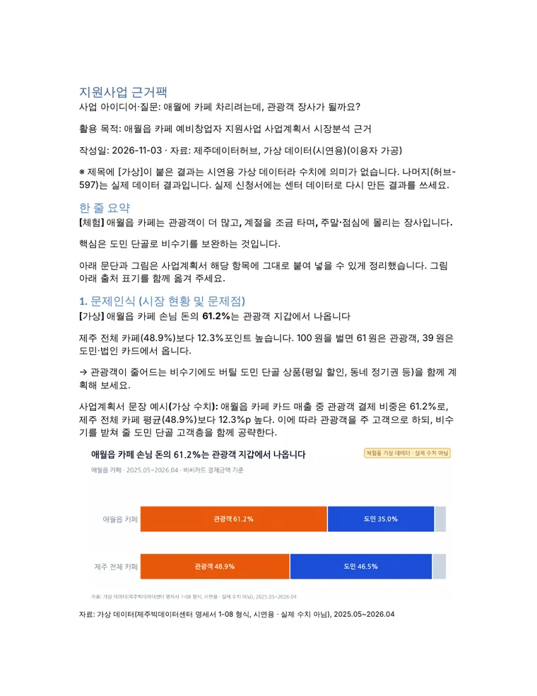
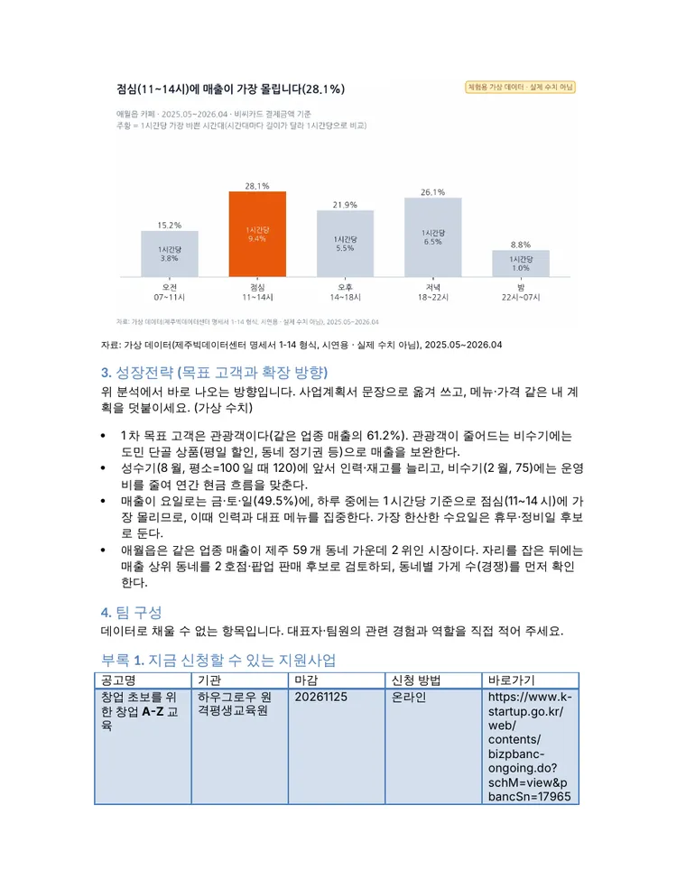
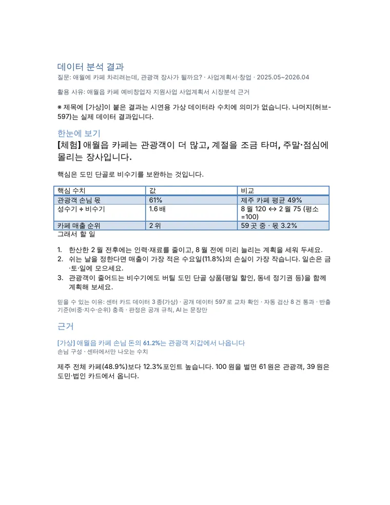

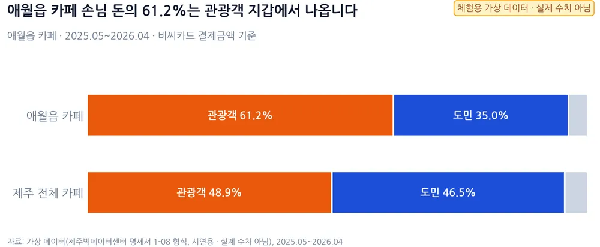
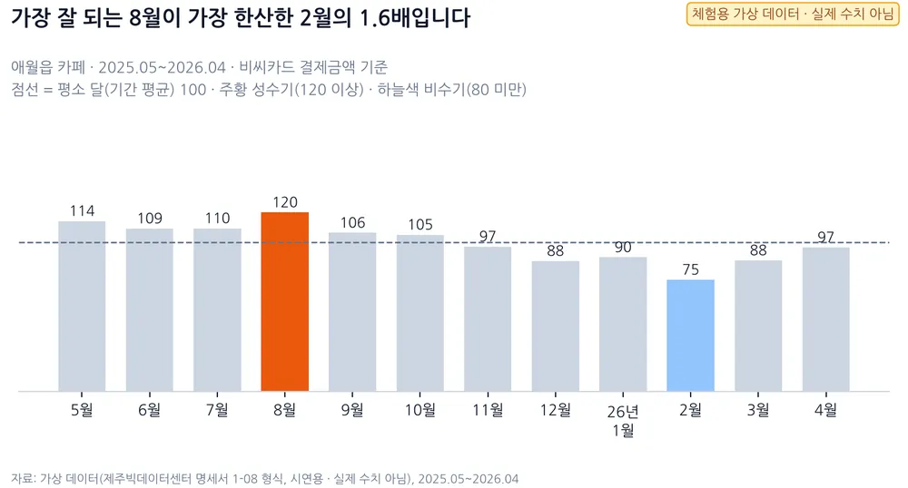
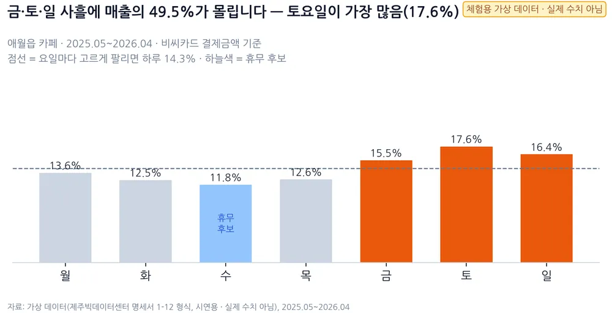
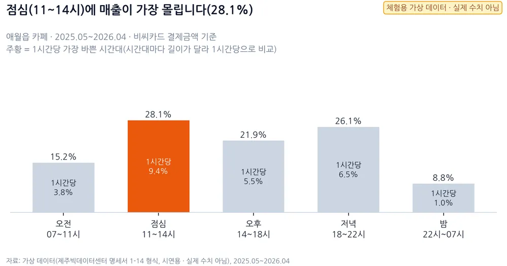
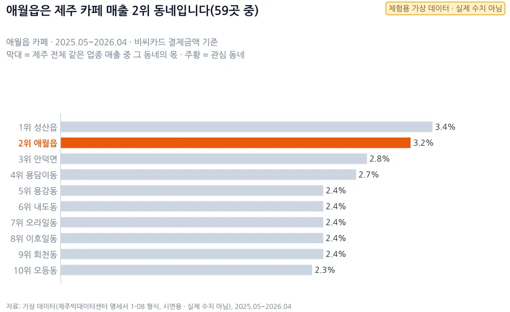
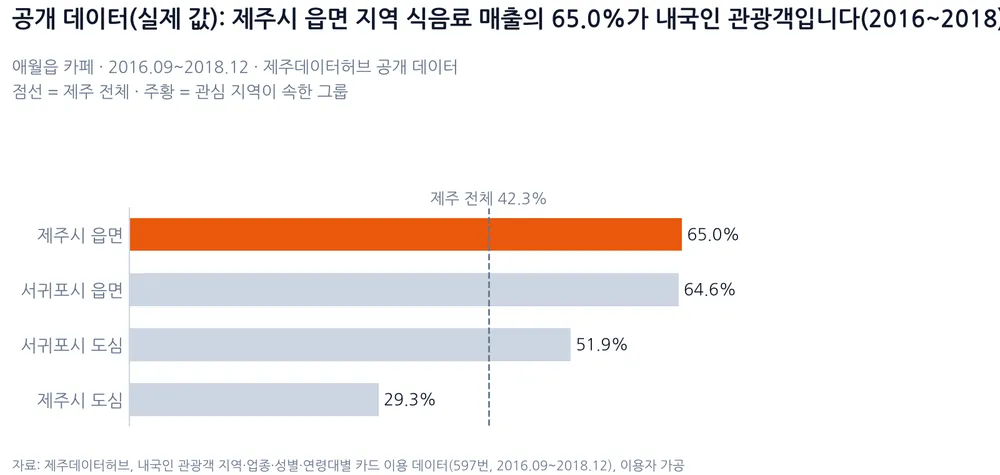

근거팩 5쪽의 성장전략(가상 수치):
- 1차 목표 고객은 관광객이다(같은 업종 매출의 61.2%). 관광객이 줄어드는 비수기에는 도민 단골 상품(평일 할인, 동네 정기권 등)으로 매출을 보완한다.
- 성수기(8월, 평소=100일 때 120)에 앞서 인력·재고를 늘리고, 비수기(2월, 75)에는 운영비를 줄여 연간 현금 흐름을 맞춘다.
- 매출이 요일로는 금·토·일(49.5%)에, 하루 중에는 1시간당 기준으로 점심(11~14시)에 가장 몰리므로, 이때 인력과 대표 메뉴를 집중한다. 가장 한산한 수요일은 휴무·정비일 후보로 둔다.
- 애월읍은 같은 업종 매출이 제주 59개 동네 가운데 2위인 시장이다. 자리를 잡은 뒤에는 매출 상위 동네를 2호점·팝업 판매 후보로 검토하되, 동네별 가게 수(경쟁)를 먼저 확인한다.

## 신청서 '시장 현황' 칸, 방문 전과 후

- **전**: "애월은 관광객이 많이 찾는 지역으로 카페 수요가 충분하다."
- **후**(근거팩 문장을 옮겨 다듬음 · 체험 수치): "애월읍 카페 카드 매출 중 관광객 결제 비중은 61.2%로, 제주 전체 카페 평균(48.9%)보다 12.3%p 높다. 이에 따라 관광객을 주 고객으로 하되, 비수기를 받쳐 줄 도민 단골 고객층을 함께 공략한다. 성수기 8월 매출은 비수기 2월의 1.6배여서 월별 인력·재고·자금 계획에 반영한다. 같은 경향은 공개 데이터에서도 확인된다(제주시 읍면 식음료 매출의 65.0%가 내국인 관광객). (자료: 제주빅데이터센터 카드 이용 현황(읍면동)_v02, 제주데이터허브 597, 이용자 가공)"

## 서윤 씨가 만족한 이유

| 막혀 있던 것 | Agent가 해 준 것 | 화면에서 보이는 곳 |
|---|---|---|
| 감만 있었다 | 센터에서만 나오는 동네 × 업종 × 관광객/도민 수치로 결론을 내고, 공개 데이터로 방향을 교차 확인 | ③ 결론 카드·근거 카드 |
| 무슨 표를 받을지, CSV를 어떻게 읽을지 몰랐다 | 질문 하나로 표 3개·기간을 정해 주고, 내려받은 파일을 알아서 알아보고, 결과를 한국어 문장으로 | ① 이렇게 이해했어요, ② 자동 인식 |
| 반출 규정을 몰랐다 | 처음부터 응용집계(비중·순위·지수)와 PNG로만 만들고, 신청서 문구와 직원용 자동 점검까지 | ④ 묶음·신청서 문구 |
| 공고가 너무 많았다 | 1,532건에서 가게 창업과 맞는 17건으로 줄여 판정, 거른 이유 공개, '가게 연 뒤' 공고는 따로 | ④ 지원사업 |
| 결과를 믿어도 되나 | 판정은 공개 규칙(같은 데이터면 같은 결론), 재현 번호, 자동 검산 8건, 주의할 점 | ③ 신뢰 줄·판정 기준 보기 |
| 센터가 내는 AI 비용 | 이 방문의 AI 비용 약 $0.0009(월 한도 $10의 0.01%). AI가 꺼져도 결론은 같음 | 화면 위 'AI 사용량 %' |

## 센터 직원 쪽에서 본 같은 하루

- **예약 상담**: 질문만 받으면 필요한 표와 기간이 바로 나와 상담이 짧아진다.
- **방문 중**: 방문자가 혼자 끝까지 간다. 직원은 반출 신청을 접수할 때 한 번만 보면 된다.
- **반출 심사**: 결과물이 처음부터 반출 기준(응용집계, PNG, 출처·활용 사유)에 맞춰져 있어 반려·재작업이 줄어든다.
- **비용 관리**: AI 사용량은 화면에 퍼센트로 보인다. 금액은 운영자 페이지에서만 본다.

## 영상으로 찍는다면 (약 2분)

| 시간 | 화면 | 내레이션 |
|---|---|---|
| 0:00 | 서윤 씨의 막힌 점 4개(자막) | "애월에 카페를 열고 싶은데, 근거는 '관광객이 많다'는 감뿐입니다." |
| 0:15 | ① 질문 입력 → "이렇게 이해했어요" | "평소 말로 물으면, 필요한 센터 데이터 3개를 알려 줍니다." |
| 0:30 | ② CSV를 내려받자 '준비됨' → 자동으로 결과로 | "내려받기만 하면 화면이 알아서 알아보고 넘어갑니다." |
| 0:45 | ③ 결론 카드, KPI 3개, 할 일 | "결론부터. 관광객 61%, 성수기 1.6배, 카페 매출 2위." |
| 1:05 | [판정 기준 보기], 공개 데이터 카드 | "판정은 AI가 아닌 공개 규칙이고, 공개 데이터로 한 번 더 확인합니다." |
| 1:20 | ④ 지원사업 1,532건 → 17건, AI 자격 대조 | "신청할 수 있는 지원사업까지 골라 줍니다." |
| 1:40 | 묶음 만들기 → 신청서 문구 → 근거팩 DOCX | "반출 신청 문구와 사업계획서용 근거팩이 한 번에 나옵니다." |
| 1:55 | 신청서 '시장 현황' 전/후 | "감이 근거가 됐습니다." |

영상 화면에는 체험 데이터라는 표시([체험], 호박색 띠)가 그대로 보이게 둔다.
